<a href="https://yash-vaidya.vercel.app">
  <picture>
    <source media="(max-width: 1011px) and (prefers-color-scheme: dark)" srcset="./assets/mobile-hero-dark.svg">
    <source media="(max-width: 1011px)" srcset="./assets/mobile-hero-light.svg">
    <source media="(prefers-color-scheme: dark)" srcset="./assets/hero-dark.svg">
    
  </picture>
</a>

  <a href="https://yash-vaidya.vercel.app"><picture><source media="(prefers-color-scheme: dark)" srcset="./assets/chip-site-dark.svg"></picture></a>
  <a href="mailto:ydvaidya23@gmail.com"><picture><source media="(prefers-color-scheme: dark)" srcset="./assets/chip-email-dark.svg"></picture></a>

  <a href="https://www.linkedin.com/in/yashvaidya23"><picture><source media="(prefers-color-scheme: dark)" srcset="./assets/chip-linkedin-dark.svg"></picture></a>
  <a href="https://yash-vaidya.vercel.app/Yash_Vaidya_Resume.pdf"><picture><source media="(prefers-color-scheme: dark)" srcset="./assets/chip-resume-dark.svg"></picture></a>

<picture>
  <source media="(max-width: 1011px) and (prefers-color-scheme: dark)" srcset="./assets/mobile-missions-dark.svg">
  <source media="(max-width: 1011px)" srcset="./assets/mobile-missions-light.svg">
  <source media="(prefers-color-scheme: dark)" srcset="./assets/missions-dark.svg">
  
</picture>

<picture>
  <source media="(max-width: 1011px) and (prefers-color-scheme: dark)" srcset="./assets/mobile-stats-dark.svg">
  <source media="(max-width: 1011px)" srcset="./assets/mobile-stats-light.svg">
  <source media="(prefers-color-scheme: dark)" srcset="./assets/stats-dark.svg">
  
</picture>

<picture>
  <source media="(max-width: 1011px) and (prefers-color-scheme: dark)" srcset="./assets/mobile-stack-dark.svg">
  <source media="(max-width: 1011px)" srcset="./assets/mobile-stack-light.svg">
  <source media="(prefers-color-scheme: dark)" srcset="./assets/stack-dark.svg">
  
</picture>

⟳ Telemetry auto-updated daily by GitHub Actions · data last changed <!--sync-->2026-11-01 11:56 UTC<!--/sync-->
